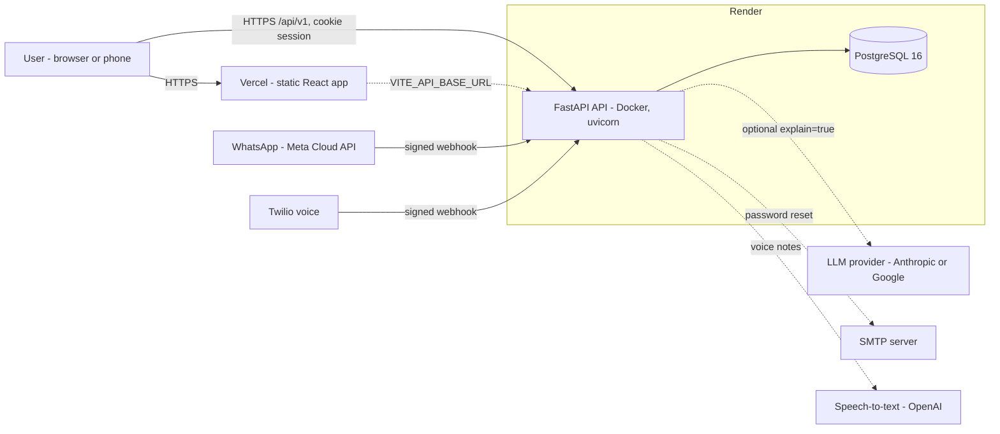
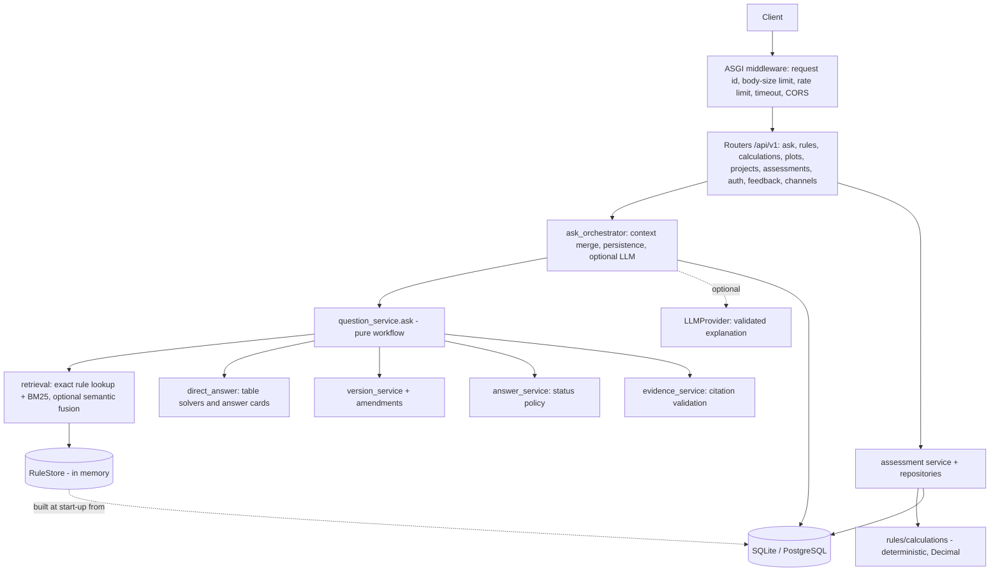
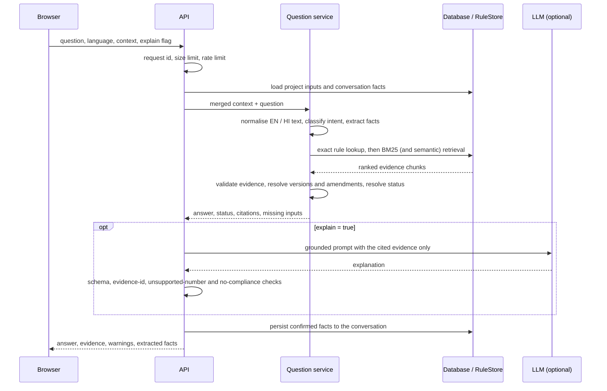
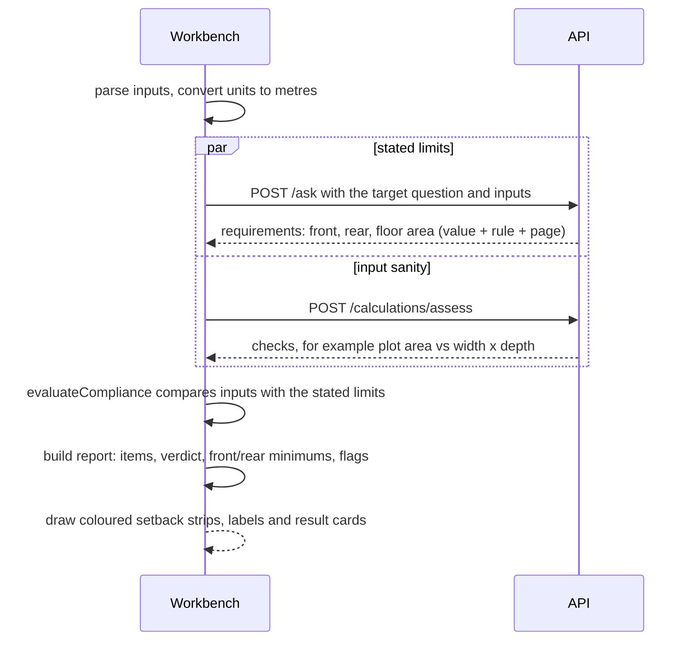
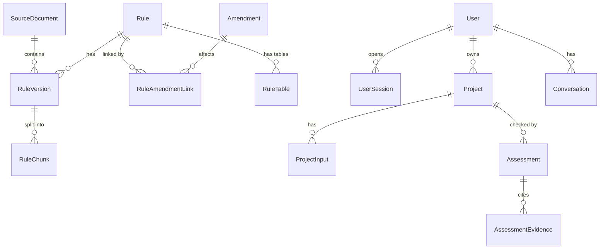
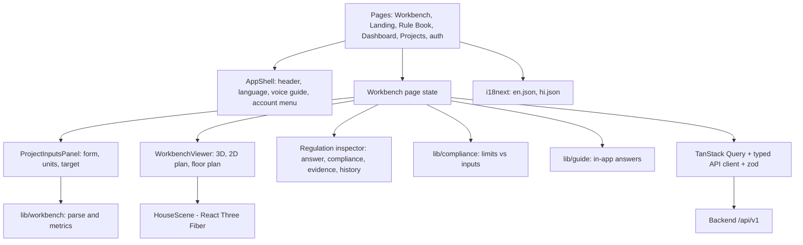
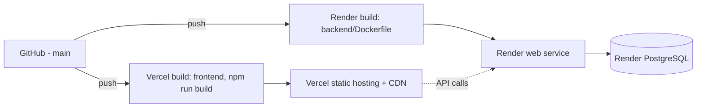

# NirmaanSetu — Bhumi Vikas Sahayak

A source-backed assistant for the **Madhya Pradesh Bhumi Vikas Rules, 2012**. Ask a question in English or Hindi, enter your plot, see the proposed house on it in 3D, and check it against the stated open-space and floor-area limits. Every answer points to its rule number and PDF page.

> **Not an official approval system.** Answers are preliminary pointers to cited rule text with an explicit verification status (all 106 rules are still `unverified`). The local permission office decides.

## Contents

1. [What the app does](#what-the-app-does)
2. [Repository layout](#repository-layout)
3. [Architecture](#architecture) — system, backend, ask flow, evaluation flow, data model, frontend
4. [Production deployment](#production-deployment)
5. [Configuration reference](#configuration-reference)
6. [Security and privacy](#security-and-privacy)
7. [Operations](#operations) — health, logging, failure behaviour, scaling
8. [Run locally](#run-locally) and [Quality gates](#quality-gates)
9. [Known limitations](#known-limitations)

## What the app does

- **Workbench** (`/workbench`): three panels on one screen.
  1. **Project inputs**: plot width and depth, road width, building use, height, floors, footprint and gaps, plus a target requirement (all open spaces, front, rear or floor area ratio). *Evaluate Compliance* runs the check.
  2. **Rule-to-Geometry Canvas**: a question bar and a 3D / 2D / floor-plan view. The proposed building is a glass volume on the plot beside the street. Setback strips are coloured blue (met), red (below the stated minimum) or amber (not judged) and labelled with their rule number. A Legend explains the colours.
  3. **Regulation inspector**: the statutory evaluation, each limit with its rule and page, answers to typed or spoken questions, evidence and history, *Explain with AI*, and *Print / Export report*.

  Both side panels fold into slim rails and remember their state. On phones the panels become Inputs / Canvas / Results tabs.
- **Rule Book** (`/rules`): search the rules and read the exact source text with its PDF page and verification status.
- **History**, **voice guide** and microphone input, in English and Hindi.
- **In-app guide**: questions about the app itself ("hi", "how do I build a home from scratch?") are answered locally without calling the rulebook.
- **Channels** (backend): WhatsApp text and voice-note answers and a phone-call (IVR) flow, using the same answer engine.
- **Accounts are optional**: visitors use the public tools; signing in lets you save projects and assessments.

The tool never says "compliant". The best outcome is *"no violation found in the checks that could be evaluated"*.

## Repository layout

```text
.
├── backend/                 FastAPI service, rule data, migrations, tests      -> backend/README.md
│   ├── app/
│   │   ├── api/             routers (/api/v1), dependencies, response mappers
│   │   ├── core/            settings, middleware, security, exceptions, logging
│   │   ├── services/        ask workflow, retrieval, versions, answers, assessment, LLM, e-mail
│   │   ├── rag/             chunking, BM25 index, optional semantic index, ranking, prompts
│   │   ├── rules/           normalisation, deterministic calculations, formula registry
│   │   ├── ingestion/       JSONL / PDF / full-text ingestion
│   │   ├── channels/        WhatsApp, voice, providers, de-duplication, PII hashing
│   │   ├── models/          SQLAlchemy models (legal, project, auth, channels)
│   │   ├── repositories/    database access
│   │   └── db/              session, bootstrap, migrations
│   ├── alembic/             schema migrations
│   ├── data/                rule corpus, amendments, evaluation sets
│   ├── scripts/             ingest, build index, validate, evaluate
│   ├── Dockerfile · docker-entrypoint.sh · docker-compose.yml
│   └── tests/               unit, integration, channels
├── frontend/                Vite + React + TypeScript UI (EN / HI)              -> frontend/README.md
│   ├── src/pages/           Workbench, Landing, RuleSearch, Dashboard, Projects, auth pages
│   ├── src/components/      layout, workbench, workbench3d, evidence, forms, landing, assistant
│   ├── src/lib/             compliance, workbench model, autofill, guide, house geometry, units
│   ├── src/api/             typed client, zod schemas, endpoints
│   ├── src/i18n/            en.json, hi.json
│   └── vercel.json          SPA rewrite + security headers
└── render.yaml              Render Blueprint (API + PostgreSQL)
```

## Architecture

### System context



The browser app is a static bundle. All rules, retrieval and calculations live in the API. The LLM, SMTP, WhatsApp, Twilio and speech-to-text integrations are optional; without them the deterministic, evidence-cited answers still work.

### Backend layers



- **The database is the source of truth.** Rule text is stored byte-for-byte; clause-aware chunks carry stable evidence ids. The in-memory BM25 store is rebuilt from the active rule versions at start-up.
- **Pure core.** Question, retrieval, version, answer and rule modules have no web or database dependency, so they are unit-testable in isolation.
- **No LLM on the critical path.** Lookup, retrieval, status, calculations and reports never call a model.

### Ask request flow (`POST /api/v1/ask`)



Answer status is resolved in priority order: no evidence or low confidence → `not_established`; version conflict → `source_conflict`; missing required inputs → `insufficient_information`; unverified evidence, pending amendment or no calculation module → `pending_verification`; assumptions or a historical version → `conditional`; otherwise `supported`. LLM output that fails any validation step is dropped and the deterministic answer is returned with a warning.

### Evaluate Compliance flow



The comparison logic lives in `frontend/src/lib/compliance.ts`. Every limit comes from the API's verbatim rule tables; nothing is hard-coded in the UI, and the verdict is never "compliant".

### Data model



Also: `PasswordReset`, `Feedback`, `IngestionRun`, and the channel tables `ChannelContact`, `ChannelLog` and `ChannelDedupe` (phone numbers are stored only as keyed hashes).

### Frontend



- **Routing and code-splitting:** React Router; heavy pages (calculator, plot check, report) and the 3D scene are lazy-loaded.
- **State:** the Workbench keeps form, conversation and panel state in the browser (session storage for the form and chat, local storage for panel layout). Nothing is sent until you ask or evaluate.
- **3D:** React Three Fiber / three.js, with a 2D SVG fallback when WebGL is unavailable.
- **Accessibility and language:** English and Hindi, keyboard-reachable controls, `prefers-reduced-motion` respected, a print stylesheet for the report.

## Production deployment



**Order of first-time setup**

1. **Render (API + database):** New → Blueprint on this repository (`render.yaml`). Set the secret values listed below when prompted. On boot, `docker-entrypoint.sh` runs migrations, loads the baked-in rules into an empty database (idempotent), then starts uvicorn on `$PORT`. Health check: `/api/v1/health`; readiness: `/api/v1/ready` (`rules_loaded` must be true).
2. **Vercel (web app):** project root `frontend/`, environment variable `VITE_API_BASE_URL=https://<render-service>.onrender.com` (origin only, no `/api/v1`). `frontend/vercel.json` provides the SPA rewrite and the security headers.
3. **Connect them:** put the Vercel origin into Render's `CORS_ORIGINS` (and `FRONTEND_URL` for password-reset links). The two services are on different sites, so the Blueprint sets `COOKIE_SAMESITE=none` (the session cookie is `Secure` and `HttpOnly`).

**Releasing:** push to `main`. Render redeploys on commit (`autoDeployTrigger: commit`); Vercel redeploys when the project is connected to the repository. Database migrations run automatically at start-up (single replica).

**After a deploy:** open the site, press *Example* then *Evaluate Compliance*, and confirm the result panel and 3D scene load. If the app says "Cannot reach the server", `CORS_ORIGINS` or `VITE_API_BASE_URL` is wrong.

## Configuration reference

Backend settings are environment variables (see `backend/.env.example` for the full list).

| Variable | Purpose | Production value |
|---|---|---|
| `APP_ENV` | `development`, `test` or `production` | `production` |
| `DATABASE_URL` | database connection (Render's `postgres://` is rewritten automatically) | from the Render database |
| `AUTH_MODE` | `none`, `api_key` or `accounts` | `accounts` |
| `API_KEY_HASHES` | hashed API keys when `AUTH_MODE=api_key` | secret |
| `CORS_ORIGINS` | allowed web origins, comma separated, no trailing slash | the Vercel origin |
| `FRONTEND_URL` | origin used in password-reset links | the Vercel origin |
| `COOKIE_SAMESITE` / `COOKIE_SECURE` | session cookie policy | `none` / true (HTTPS) |
| `SESSION_TTL_HOURS` | session lifetime | default 14 days |
| `RATE_LIMIT_PER_MINUTE` | per API key (or per IP) | `240` |
| `MAX_REQUEST_BYTES`, `REQUEST_TIMEOUT_SECONDS`, `MAX_QUESTION_CHARS` | request limits | defaults |
| `INGEST_ON_START` | the container start-up script loads the baked-in rules into an empty database (migrations always run first) | `1` |
| `AUTO_MIGRATE`, `AUTO_INGEST` | in-app alternatives to the above when not using the Docker entrypoint | unset |
| `WEB_CONCURRENCY`, `FORWARDED_ALLOW_IPS` | workers; trust the platform proxy for real client IPs | `1`, set |
| `SMTP_HOST`, `SMTP_USER`, `SMTP_PASSWORD`, `SMTP_FROM` | password-reset e-mail (without it the API reports e-mail unavailable) | secret |
| `LLM_PROVIDER`, `LLM_MODEL`, `ANTHROPIC_API_KEY` or `GOOGLE_API_KEY` | optional validated explanations | optional |
| `SEMANTIC_ENABLED` | optional embedding retrieval | `false` |
| `WHATSAPP_*`, `TWILIO_*`, `PUBLIC_BASE_URL`, `PII_HASH_SECRET`, `STT_PROVIDER`, `OPENAI_API_KEY` | WhatsApp / voice channels | optional |

Frontend: `VITE_API_BASE_URL` only (build-time). A production build that contains `localhost:8000` fails `npm run verify` on purpose.

## Security and privacy

- **Authentication modes:** open (local), API-key (hashed, constant-time compare), or accounts with server-side sessions in an `HttpOnly`, `Secure` cookie. Passwords are hashed; login errors are generic; password-reset tokens are single-use.
- **Isolation:** projects, assessments and conversations are scoped to their owner; guests cannot read owned data.
- **Abuse limits:** per-key / per-IP rate limit with `Retry-After`, request-body limit, per-request timeout, bounded question length.
- **Browser hardening** (`frontend/vercel.json`): strict Content-Security-Policy (no inline scripts), `X-Frame-Options: DENY`, `nosniff`, referrer policy, and a permissions policy that allows only the microphone (for voice input).
- **Channels:** WhatsApp and Twilio webhooks are signature-verified; messages are de-duplicated; phone numbers are stored only as keyed hashes (`PII_HASH_SECRET`).
- **LLM safety:** the model only sees the retrieved evidence; its output is checked against the schema, the cited evidence ids and the numbers present in the evidence, and may not claim compliance.
- **Secrets** are never committed (`.env*` is git-ignored; only `.env.example` is tracked).

## Operations

- **Request tracing:** every response carries `X-Request-ID`; access logs are structured and contain no bodies or headers.
- **Probes:** `/api/v1/health` (process up), `/api/v1/ready` (database reachable, schema migrated, rules loaded; returns booleans only).
- **Failure behaviour**

| Failure | Behaviour |
|---|---|
| Database down | `/ready` 503; other DB endpoints 500 with the request id |
| Schema not migrated / no rules ingested | start-up succeeds; readiness reports it; ask returns an explicit "not established" |
| LLM not configured and `explain=true` | 503 `llm_unavailable`; the same request with `explain=false` works |
| LLM error, timeout or invalid output | 200 with the deterministic answer plus a warning |
| Handler timeout / oversized body / rate limit | 504 / 413 / 429 (with `Retry-After`) in a JSON envelope |
| Unhandled exception | generic 500 envelope (no internals), logged with the request id |

- **Scaling:** the rule index is built in memory at start-up, so each replica holds its own copy. Run a single replica while migrations run at boot; to scale out, run migrations as a separate release step. Restart after re-ingesting rules.
- **Data refresh:** `scripts/ingest_jsonl` (rules and amendments) and `scripts/ingest_pdfs` (source PDFs) are idempotent.

## Run locally

Windows PowerShell; needs Python 3.12 and Node 20+.

```powershell
# --- backend (terminal 1) ---
cd backend
py -3.12 -m venv .venv
.\.venv\Scripts\python -m pip install -r requirements-dev.txt
.\.venv\Scripts\python -m alembic upgrade head
.\.venv\Scripts\python -m scripts.ingest_jsonl --load-db
.\.venv\Scripts\python -m uvicorn app.main:app_factory --factory --port 8000      # http://localhost:8000/docs

# --- frontend (terminal 2) ---
cd frontend
copy .env.example .env.local        # VITE_API_BASE_URL=http://localhost:8000
npm ci
npm run dev                         # http://localhost:5173  (use localhost, not 127.0.0.1: CORS)
```

macOS/Linux: use `python3.12 -m venv .venv && . .venv/bin/activate` and `cp`. Local mode uses SQLite and no API key.

## Quality gates

```powershell
# backend
cd backend
.\.venv\Scripts\python -m pytest -q
.\.venv\Scripts\ruff check app scripts tests
.\.venv\Scripts\python -m scripts.validate_rules --db
.\.venv\Scripts\python -m scripts.evaluate_rag --db

# frontend
cd frontend
npm run verify                      # typecheck, lint, tests, build, bundle and contrast checks
npm run test:contract               # needs the backend running on :8000
$env:LIVE_API_URL="http://localhost:8000"; npm run test:live
```

## Known limitations

- Rule text is **not yet human-verified**; every rule is `unverified`, so results are guidance only and no regulatory formula is registered as verified.
- Side open-space minimums depend on the building type and are shown with their rule but not judged automatically.
- The optional LLM explanation and semantic retrieval are validated with fake providers; treat them as experimental until run against live services in your environment.
- The Hindi PDF uses a legacy font encoding and is not searchable; Hindi answers come from the English rule text.
- The 3D model is an illustration from your inputs, not a verified design.
- See [backend/README.md](backend/README.md) and [backend/docs/architecture.md](backend/docs/architecture.md) for detail, and the "not verified" notes there for what has and has not been exercised in deployment.
