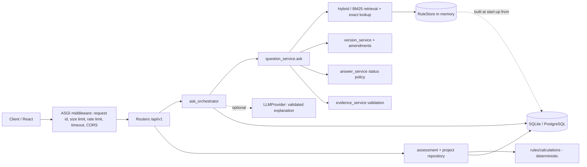
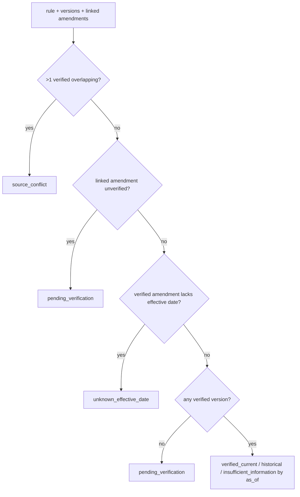

# Architecture

## Components and boundaries

* **Source of truth = database.** `RuleVersion.original_text` is stored byte-for-byte; `RuleChunk` rows (clause-aware pieces) carry stable `evidence_id`s. The in-memory BM25 `RuleStore` is rebuilt from *active* versions at start-up (restart after ingestion).
* **Pure core.** `question_service`, `retrieval_service`, `version_service`, `answer_service`, `rules/*` have no web or DB dependency; `ask_orchestrator` and the repositories add context, persistence and the optional LLM step.
* **No LLM on the critical path.** Lookup, retrieval, status, calculations and reports never call a model.

## Request flow for `POST /ask`

1. Merge context (lowest to highest priority): project inputs -> stored conversation facts -> request `context` (strictly validated).
2. Normalise query (EN / HI / code-switched, Devanagari digits, rule-number references; original preserved).
3. Classify intent (deterministic patterns); extract facts (value, unit, source, validation, confidence).
4. Unknown rule number -> abstain (no fuzzy neighbours). Out-of-scope -> `not_established`.
5. Retrieve: exact rule number first, then BM25 (optionally fused with semantic ranks). Confidence = lexical coverage of the top chunk.
6. Validate evidence (id resolves, excerpt equals stored text, rule exists, page metadata present).
7. Resolve version per rule against linked amendments; resolve answer status; compose a pointer-style answer with citations.
8. Persist user-stated facts to the conversation. If `explain=true`: LLM explanation -> schema check -> evidence-id check -> unsupported-number check -> no-compliance-claim check; rejected output is dropped with a warning.

## Status resolution (priority order)

no evidence / low confidence -> `not_established`; version conflict -> `source_conflict`; missing required inputs -> `insufficient_information`;
unverified evidence, pending amendment, unknown date or no calculation module -> `pending_verification`; assumptions or historical version -> `conditional`; else `supported`.

## Version resolution

The newest document is never treated as proof of applicability; an amendment affects a rule only through an explicit link.

## Calculation pipeline

`input_service` (names, units, dimensions, magnitude) -> `rules/calculations` (Decimal, `ROUND_HALF_UP`, trace with formula id/source/inputs/intermediates) -> `CalculationTrace`.
General arithmetic carries `verification_status=not_applicable_general_arithmetic`. Regulatory formulas live in a registry that ships **empty** and refuses unverified entries.

## Failure handling

| Failure | Behaviour |
|---|---|
| DB down | `/ready` 503 (booleans only); other DB endpoints 500 with request id |
| Schema not migrated | `/ready` 503 + note; store not built |
| No rules ingested | start-up OK; search/ask return explicit no-data / `not_established` |
| LLM not configured and `explain=true` | 503 `llm_unavailable`; same request with `explain=false` works |
| LLM error/timeout/invalid output | 200 with deterministic answer + warning |
| Handler exceeds timeout | 504 JSON envelope |
| Oversized body / rate limit | 413 / 429 (+`Retry-After`) |
| Unhandled exception | 500 generic envelope (no internals), logged with request id |
