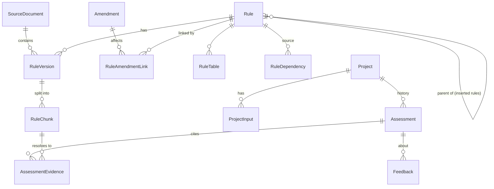

# Data model

| Table | Purpose / key constraints |
|---|---|
| `source_documents` | `doc_key` unique. Dates (`publication`, `effective`, `consolidation`) are NULL unless stated by the document. `file_hash` = SHA-256 of the file. |
| `rules` | `stable_rule_id` unique (normalised key, e.g. `26b`); `official_rule_number` keeps the printed label (`26-B`, `25(A)`). `parent_rule_id` links inserted rules embedded in a parent record. |
| `rule_versions` | UNIQUE(`rule_id`,`source_document_id`,`content_hash`). `version_status` = `active`/`superseded`; `verification_status` separate. `effective_from/until` NULL = unknown. `original_text` never modified. |
| `rule_chunks` | Derived retrieval units; `evidence_id` unique = the citation key; page precision recorded. |
| `amendments`, `rule_amendment_links` | `effective_date` is never inferred from `publication_date`; `stated_date` holds a secondary-source date without promoting it. Links carry `clause_path` (`5/c`). |
| `rule_tables` | Reserved for *verified* numeric tables; auto-extracted tables are written to `data/processed/pdf_tables_candidates_*.jsonl` as `unverified` and are not loaded. |
| `rule_dependencies` | Rule -> rule/calculation dependencies (empty until verified). |
| `projects`, `project_inputs` | Inputs keep unit, `input_source`, `verification_status` (user entries are `unverified`). `owner_id` enforces isolation. |
| `assessments` | Immutable: `input_snapshot`, `calculation_results`, warnings, `rule_version_snapshot` (version key + content hash), `as_of`, optional `report`. |
| `assessment_evidence` | Exact stored text + page reference + role (`related_context`) + verification at assessment time. |
| `feedback`, `conversations`, `ingestion_runs` | User reports; carried facts between turns; audit of ingestion runs (input hash + report). |

## Version history

A re-import never overwrites. Identical content is a no-op; changed content creates a new `RuleVersion`, marks the previous active one `superseded`, and does **not** inherit `verified`. Reviewer decisions on old versions are preserved. Assessments reference the versions they used, so they stay explainable after rules change.

## Why a few JSON columns

`flags`, `embedded_rules`, `extra` (unmodelled source fields, page cross-check), `calculation_results`, `input_snapshot`, `facts` are variable, read-whole structures. Everything relational (rules, versions, links, projects, inputs, evidence) is normalised.
